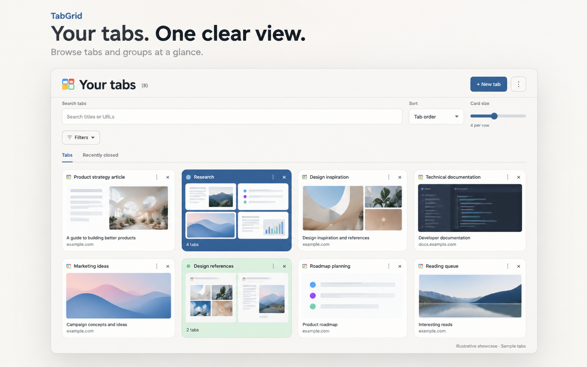
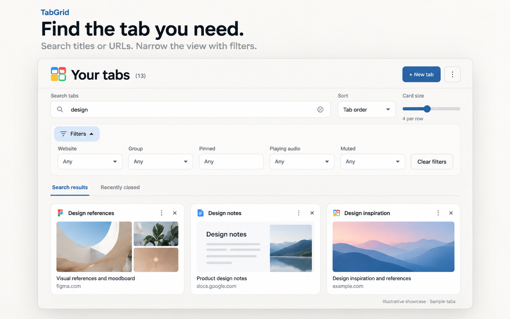
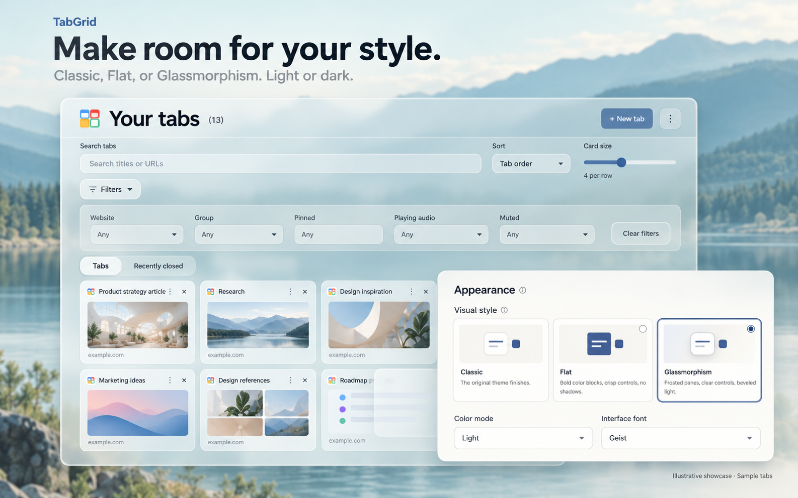

# TabGrid

[English](README.md) · [简体中文](README.zh-CN.md) · **日本語**

デスクトップ版 Chrome のタブとグループを、ひとつの見やすいグリッドにまとめる拡張機能です。検索、整理、外観のカスタマイズをローカルで行えます。アカウントは不要です。

## インターフェースを見る

**開いているタブをすばやく見つける。** ページプレビューとグループをひとつのグリッドで確認し、タイトルや URL の検索とフィルターで絞り込めます。

**自分に合った外観に。** クラシック、フラット、グラスモーフィズムから選び、ライト・ダークモード、フォント、色、背景をカスタマイズできます。

*これらは実際のインターフェースを参考に AI で生成したイメージです。サンプルのタブとサムネイルを使用しており、正確なスクリーンショットではありません。[画像について（英語）](docs/showcase-artwork.md)。*

## インストール

**Chrome 120 以降**が必要です。依存ライブラリとフォントは同梱されているため、ソースからのインストールにコマンドやビルドは不要です。

1. GitHub のリポジトリページで **Code → Download ZIP** を選びます。
2. ZIP を展開し、フォルダを継続して使用する場所に保存します。
3. `chrome://extensions` を開き、**デベロッパーモード**を有効にします。
4. **パッケージ化されていない拡張機能を読み込む**をクリックし、`manifest.json` があるフォルダを選びます。
5. Chrome の拡張機能メニュー（パズルのアイコン）で **TabGrid** を固定します。
6. 拡張機能のアイコンをクリックして TabGrid を開きます。

画像付きの手順は [Chrome のガイド](https://developer.chrome.com/docs/extensions/get-started/tutorial/hello-world#load-unpacked)をご覧ください。更新するには、インストール先のファイルを最新版で置き換え、拡張機能の管理画面で**再読み込み**してから TabGrid を開き直します。

小さいインストール用パッケージを作るには、`npm run package` を実行し、`dist/TabGrid` を読み込むか `dist/TabGrid.zip` を展開します。このパッケージには実行に必要なファイルとライセンス通知が含まれ、テスト素材、開発用スクリーンショット、ソースマップ、未使用の依存ファイルは含まれません。

## 使い方

- **タブとグループを開く：**タブをクリックするとそのページに切り替わり、グループをクリックすると中のタブを表示します。グループの色は Chrome と一致し、最後に開いたタブやグループが強調表示されます。
- **タブを探す：**検索欄に入力します。**フィルター**を開くと、サイト、グループ、固定状態、音声再生、ミュートで絞り込めます。**並べ替え**と**カードサイズ**で表示を調整できます。
- **カードを移動する：**ドラッグで並べ替えます。別のタブやグループに重ね、対象が強調表示されたら離すとグループ化します。並べ替える場合は、対象の反対側の端を越えるまで動かします。グループ内では、下部の**グループから削除**で離すとグループを解除します。パネルの外で保持すると、メイングリッドでドラッグを続けられます。並べ替えには**タブの順序**を選び、文字検索とグループ以外のフィルターを解除してください。ドラッグによるグループ化は初期状態で有効、グループのドロップ先ドロワーは無効です。
- **スワイプで閉じる：****設定 → タブとグループ**で有効にし、マウスでカードを左右にドラッグします。短いドラッグや主に縦方向のドラッグでは閉じません。並べ替えやグループ化には、クリックして少し保持してから動かします。確認と取り消しも利用できます。
- **カテゴリーを切り替える：**カテゴリー欄より下でタッチパッドを 2 本指で横にスワイプすると、タブ、アイドルタブ（有効な場合）、最近閉じたタブを切り替えます。検索中は「すべての結果」も表示されます。1 回のジェスチャーで 1 カテゴリー移動し、縦スクロールも使えます。
- **ウィンドウをまたいで操作する：****⋮ → すべてのウィンドウを表示**を有効にし、ウィンドウの区画間でカードをドラッグしてタブやグループを移動します。
- **複数のタブを操作する：****⋮ → タブを選択**からカードを選び、**編集**を開きます。個別の操作は右クリックまたはカードの三点ボタンで行います。
- **閉じる・復元する：****×** でタブやグループを閉じます。通常のウィンドウでは**元に戻す**で直前の操作を取り消すか、**最近閉じたタブ**から復元できます。**アイドルタブ**は古いタブを分けて表示し、自動的には閉じません。

**/** で検索欄に移動します。テキスト入力欄以外では **Ctrl+Z**（Windows/Linux）または **⌘Z**（Mac）で取り消し、**Escape** でメニューやダイアログを閉じます。

通常のウィンドウではグループ化とグループ解除も**元に戻す**で取り消せます。通知は画面下部の中央に表示します。ミュート中のカードのスピーカーアイコンを押すとミュートを解除できます。検索履歴は項目の **×** で削除でき、矢印キーで選んで **Delete** を押す方法も使えます。

ツールバーのアイコンや Chrome のショートカットから TabGrid を開くと、同じ通常／シークレット環境の既存グリッドを、別ウィンドウにある場合も再利用します。手動で複製・復元したグリッドは閉じません。自動的に閉じると Chrome の「最近閉じたタブ」に新たな項目が追加され、復元を繰り返すループになるためです。Chrome には、これらの終了を記録から除外するための拡張機能 API がありません。**設定 → タブとグループ**の**タブに切り替えた後に TabGrid を閉じる**を有効にすると、タブカードを選択したときだけグリッドを閉じます。初期設定は無効です。次回の表示状態はブラウザーセッション内に一時保存し、元に戻す操作が利用できる間は閉じません。この設定による終了も Chrome の「最近閉じたタブ」に表示される場合があります。

## カスタマイズ

**⋮ → 拡張機能の設定**を開きます。有効な変更は自動保存されます。

- **一般：**言語、検索内容やスクロール位置、ウィンドウ範囲の記憶、検索欄のフォーカス動作を設定します。
- **外観：**ライト、ダーク、システムに合わせるモードを選びます。スタイル、色、フォント、アニメーション、カードの詳細も変更できます。
- **検索とフィルター：**検索対象、表示するフィルター、ローカル検索履歴（初期状態では無効）を設定します。
- **タブとグループ：**新しいタブの動作、閉じる前の確認、取り消し可能な時間、アイドルの除外サイトを設定します。
- **カスタム背景：**外観で1 GB 以下のローカルの JPG、PNG、WebP 画像を選びます。プレビューのドラッグで位置を、ズームで切り抜きを調整し、透明度やぼかしも変更できます。大きな画像は長辺 2,560 ピクセル以内に縮小し、小さい WebP として保存します。元のファイルは変更しません。画像の置き換え、リセット、削除はいつでも可能です。
- **プレビューとストレージ：**撮影の有効・無効、低／標準／高画質、除外サイト、保存容量の上限を設定し、保存済みプレビューを削除できます。画質の変更は今後の撮影に適用され、初期値は標準です。
- **キーボード：**ページ内のショートカットを設定するか、Chrome の編集画面で **TabGrid を開く**ショートカットを指定します。
- **バックアップ：**設定をローカルの JSON ファイルに書き出したり、インポート内容を確認して適用できます。閲覧履歴、タブの URL、スクリーンショット、背景画像は含まれません。

初期状態では Chrome の言語に従い、英語、簡体字中国語、日本語を表示します。他の中国語の地域設定でも簡体字を使用します。**設定 → 一般 → 言語**で指定でき、変更すると画面が再読み込みされます。タブのタイトル、グループ名、検索内容、サイトのアドレスは翻訳しません。Chrome の拡張機能一覧の説明とコマンド名は、Chrome 自体の言語設定に従います。

## プライバシーとオフライン利用

画面、設定、フォント、タブの整理はローカルで動作し、サーバーやクラウド同期を使いません。各サイトの閲覧には、そのサイトに必要なネットワーク接続が必要です。

通常のタブを開いたとき、アクティブにしたとき、読み込みが完了したとき、およびスクロールや操作が落ち着いたときにプレビューを更新します。表示中でフォーカスされているページは約 15 秒ごとにも更新します。Chrome の実行中は 30 秒間隔のバックグラウンド確認で補います。ツールバーのアイコンや Chrome のショートカットで TabGrid を開くと、切り替える前に現在のページを撮影します（通常のサイトは最大 250 ミリ秒、制限付きページは最大 1 秒待機）。この明示的な操作により、Chrome が一時的な `activeTab` 権限を付与し、新しいタブ、Chrome 内部ページ、Chrome ウェブストアなどを撮影できる場合があります。一部の撮影は Chrome が拒否することがあり、その場合はサイトのアイコンを表示します。ファイルのページには Chrome のファイルアクセス許可も必要です。制限付きページにスクリプトを注入しません。

既に開いている TabGrid タブへ直接切り替えた場合は、最後に保存したプレビューを使用します。拡張機能を明示的に呼び出して撮影に成功した後は、現在のブラウザーセッション中、同じ制限付きタブと同じ URL の自動更新を再試行できます。撮影のたびに Chrome が権限を確認します。移動、タブを閉じる操作、プレビューの消去、撮影の拒否によって、この記録は削除されます。複数の新しいタブを順に表示してから TabGrid タブに直接切り替えても、撮影の権限は付与されません。撮影したいページをアクティブにした状態で、TabGrid のツールバーアイコンか Chrome のショートカットを使用してください。新しい画像は縦横比を保ち、960 × 600 ピクセル以内に縮小します。小さい画像は拡大しません。これはローカルのプレビュー保存容量を減らすもので、拡張機能のインストール容量とは別です。サイトの除外設定も引き続き適用されます。

TabGrid は Chrome の権限を使ってタブやグループを管理し、最近閉じた項目を表示し、プレビューを撮影します。プレビューと拡張機能自身の閲覧関連データはローカルの Chrome ストレージに保存されます。ブックマーク、リーディングリスト、サイトのミュート権限は、使用時にだけ要求します。

プライベートブラウジングでは、Chrome の拡張機能詳細で**シークレットモードでの実行を許可する**を有効にします。通常タブとシークレットタブは分離されます。シークレットモードではスクリーンショット、検索履歴、TabGrid の取り消し記録を保存しません。

## クレジット

以下のオープンソースプロジェクトに感謝します。

- [Material Design のモーション](https://m3.material.io/styles/motion)：カードが自然に戻る動きの参考。既存の AutoAnimate で実装しています。
- [Google Material Design Icons](https://github.com/google/material-design-icons)：メニューと設定のアイコン（[Apache 2.0](assets/icons/material/LICENSE)）。
- [SortableJS](https://github.com/SortableJS/Sortable)：ドラッグによる並べ替え（[MIT](node_modules/sortablejs/LICENSE)）。
- [FormKit AutoAnimate](https://github.com/formkit/auto-animate)：画面とカードのアニメーション（[MIT](node_modules/@formkit/auto-animate/LICENSE)）。
- [Liquid DOM](https://github.com/AndrewPrifer/liquid-dom)：グラスモーフィズムのコントロール、フィルター、メニュー、ダイアログ、スライダーに使う WebGPU 背景屈折とスプリングアニメーション（[MIT](assets/licenses/liquid-dom.txt)）。ローカル画像を使い、実験的な HTML-in-Canvas フラグは不要です。WebGPU または背景画像がない場合は CSS に切り替わります。
- [Geist / Geist Mono](https://github.com/vercel/geist-font)、[Outfit](https://github.com/Outfitio/Outfit-Fonts)、[Plus Jakarta Sans](https://github.com/tokotype/PlusJakartaSans)、[Newsreader](https://github.com/productiontype/Newsreader)：同梱フォント（SIL Open Font License）。
- [Chromium / Android 版 Chrome](https://chromium.googlesource.com/chromium/src/)：重なりによるグループ化、並べ替えの境界、グループパネルのアニメーションの動作参考。[調査とデスクトップ向けの調整](docs/chrome-grid-interaction-research.md)、[Chromium ライセンス](https://chromium.googlesource.com/chromium/src/+/main/LICENSE)。
- [Leonxlnx の taste-skill](https://github.com/Leonxlnx/taste-skill)：レイアウトとスタイルの参考（[MIT](assets/licenses/taste-skill.txt)）。

外観は [Flat UI](https://github.com/designmodo/Flat-UI)、[liquidGL](https://github.com/naughtyduk/liquidGL)、[neumorphism](https://github.com/adamgiebl/neumorphism)、[clay.css](https://github.com/codeAdrian/clay.css) から着想を得ています。TabGrid 独自の CSS で実装しており、これらのランタイムは同梱していません。

パッケージには依存ライブラリのライセンス通知を残してください。Liquid DOM layout の個別通知も必要です。通知はライブラリ、[フォント](assets/fonts/README.md)、[Material アイコン](assets/icons/material/README.md)に同梱されています。

制限付きページの撮影は、Chrome の公式 [captureVisibleTab](https://developer.chrome.com/docs/extensions/reference/api/tabs#method-captureVisibleTab) と [activeTab](https://developer.chrome.com/docs/extensions/develop/concepts/activeTab) API を使用して独立に実装しています。[Tab Thumbnails](https://chromewebstore.google.com/detail/tab-thumbnails/adcmjkdmkpfdlhinedckkklaklijifpo) は動作の参考として調査しましたが、コードや素材は含めていません。調査した配布物には再利用ライセンスが見つかりませんでした。

## 開発

`npm test` と `npm run check` で検証します。画面のローカルテストには `node tests/preview-server.mjs` を実行し、`http://127.0.0.1:4173` を開きます。テスト画面は模擬タブを使用します。確認済みの動作と実際のブラウザでの確認事項は[検証メモ](docs/verification.md)をご覧ください。

Node.js 20 以降で `npm run package` を実行すると、`dist/TabGrid/` と `dist/TabGrid.zip` を作成します。パッケージ処理はローカルの実行時依存関係をたどり、第三者の通知を保持します。追加のビルド依存は不要です。画面の翻訳は `locales/`、Chrome のメタデータは `_locales/` にあります。プレースホルダーの番号を各言語で一致させ、ユーザーの内容ではなく画面のメッセージだけを翻訳してください。
